# 10 задач для отработки BIOS/UEFI в Lenovo BIOS Simulator Center
Симулятор: https://download.lenovo.com/bsco/index.html

Выберите устройство ThinkPad (например, T14s Gen 5 или X1 Carbon Gen 12) в графическом режиме. Ниже — тайминг и критерии выполнения для каждой задачи.

**Выбранное устройство - T14s Gen 5**

## Задача 1. Навигация по основным разделам

Цель: Запомнить структуру меню UEFI.
Задание: Последовательно откройте разделы Main, Config, Security, Startup, Restart. Выпишите, какая информация отображается в Main (серийный номер, версия UEFI, тип CPU).
Критерий готовности: Вы можете без подсказки назвать, в каком разделе находится каждая из настроек из задач 2–5.

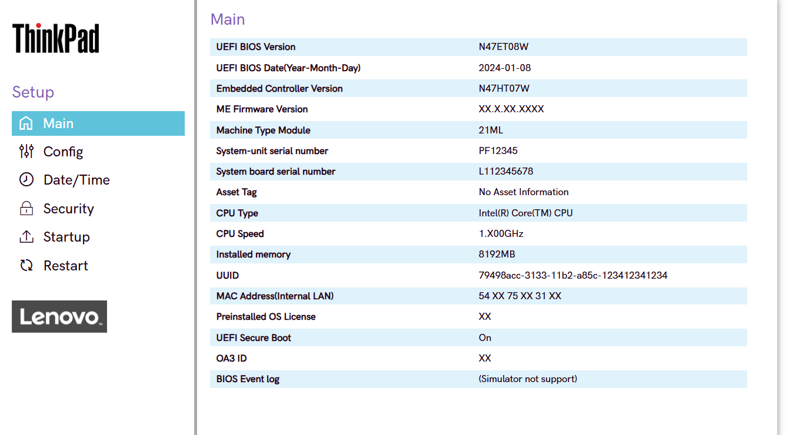

- Серийный номер: PF12345 
- Версия UEFI: N47ET08W
- Тип процессора: Intel(R) Core(TM) CPU 

## Задача 2. Смена порядка загрузки

Цель: Научиться менять приоритет загрузочных устройств.
Задание: Перейдите в Startup → Boot. Сделайте USB первым, NVMe — вторым. Запомните клавишу сохранения (F10).
Критерий готовности: Порядок изменён, вы знаете, где он отображается после повторного входа.

Перейдходим в Startup → Boot и ставим USB на первые места, так они будут в приоритете. 

## Задача 3. Включение/выключение Secure Boot

Цель: Понять назначение Secure Boot.
Задание: Перейдите в Security → Secure Boot. Проверьте статус, переключите на противоположный, верните обратно. Отметьте, требуется ли перезагрузка.
Критерий готовности: Вы можете объяснить, зачем нужен Secure Boot и где он включается.

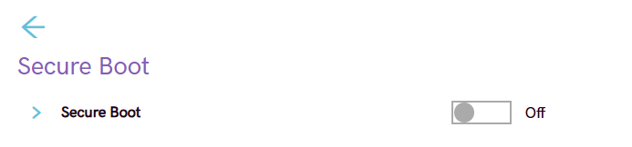

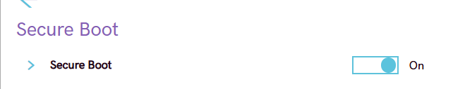

Изначально Secure Boot включен. При выключении и включении перезагрузка не требуется, так как это эмулятор, однако, в реальном устройстве перезагрузка потребуется.

## Задача 4. Установка пароля супервизора

Цель: Отработать установку пароля администратора UEFI.
Задание: Перейдите в Security → Password → Supervisor Password. Установите пароль Test1234. Попробуйте изменить любую настройку — должен появиться запрос пароля. Затем сбросьте пароль.
Критерий готовности: Пароль установлен, проверен и снят.

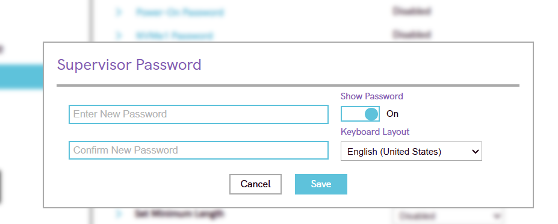

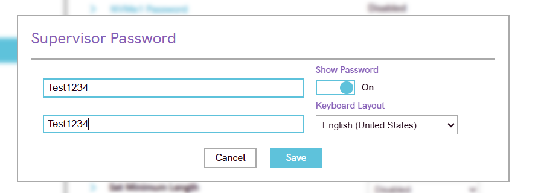

После сохранения пароля реальное устройство будет его запрашивать после каждого изменения, но эмулятор не запрашивает его.

## Задача 5. Сброс на заводские настройки

Цель: Научиться возвращать UEFI к исходному состоянию.
Задание: Перейдите в Restart → Load Factory Defaults (или F9). Подтвердите сброс. Проверьте, что настройки из задач 2–4 сброшены.
Критерий готовности: Настройки вернулись к исходным, вы знаете комбинацию для сброса.

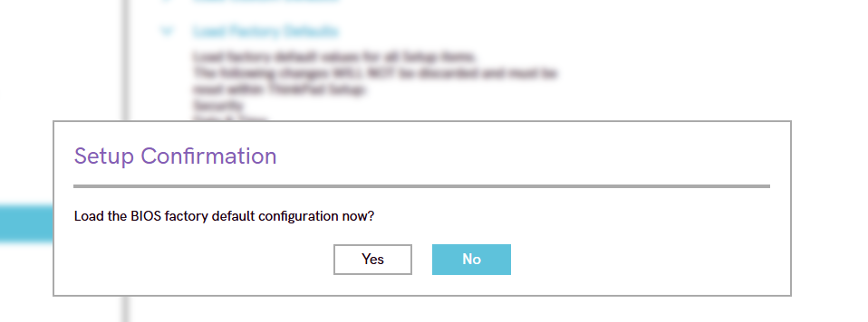

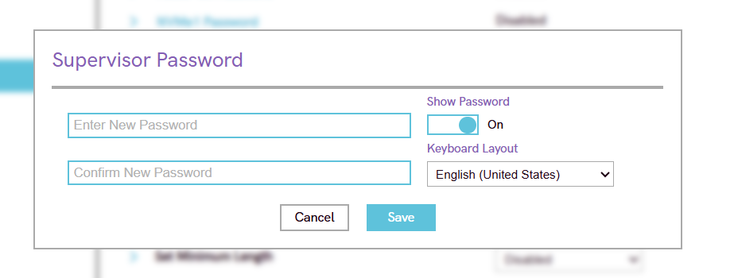

После подтверждения сброса, все настройки, в том числе пароли, сбрасываются.

## Задача 6. Управление встроенными устройствами

Цель: Отработать управление периферией на низком уровне.
Задание: Перейдите в Config → USB. Найдите USB BIOS Support или Always On USB. Отключите, затем включите обратно. Запишите точный путь.
Критерий готовности: Вы знаете, где отключается USB-поддержка в UEFI.

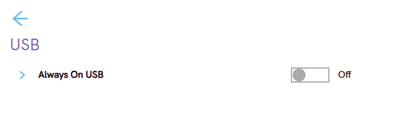

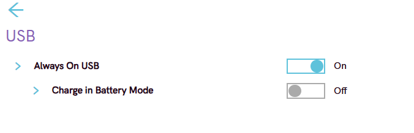

В данном эмуляторе отсутствует USB BIOS Support. Always On USB - есть. Полный путь Config → USB → Always On USB.

## Задача 7. Режим работы SATA/NVMe

Цель: Понять разницу между режимами контроллера.
Задание: Перейдите в Config → Storage → SATA Controller Mode (или NVMe Mode). Посмотрите варианты (AHCI / RAID / Intel RST), переключите и верните обратно. Обратите внимание на предупреждения.
Критерий готовности: Вы можете назвать доступные режимы и риски их смены.

В данном эмуляторе отсутствует Storage.

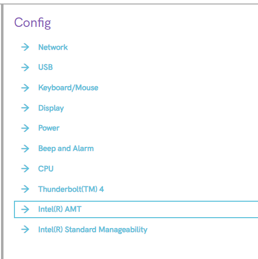

## Задача 8. Временное меню загрузки (эмуляция F12)

Цель: Научиться использовать Boot Menu без изменения постоянных настроек.
Задание: Найдите опцию Startup → Boot Mode или эмуляцию F12 Boot Menu. Активируйте, затем вернитесь в главное меню.
Критерий готовности: Вы понимаете разницу между постоянным порядком загрузки и временным выбором устройства.

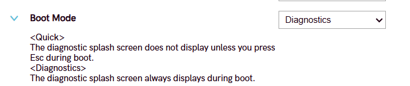

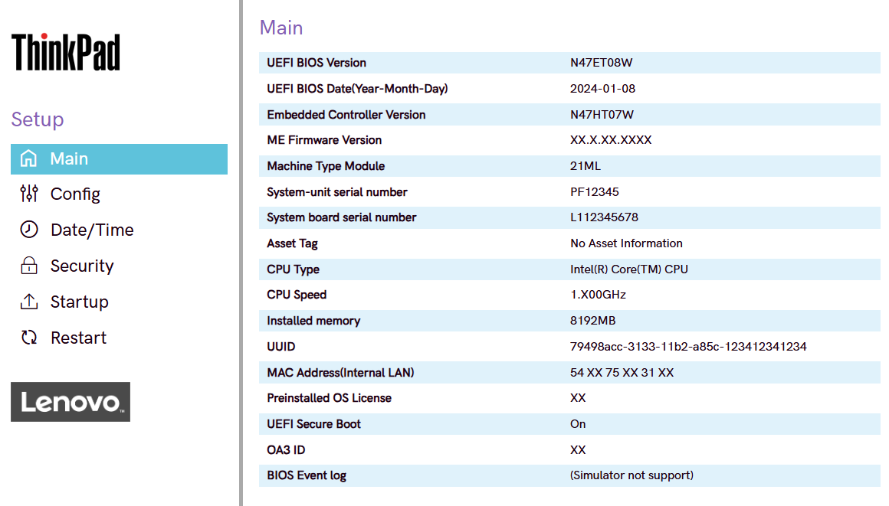

Boot Mode был поменян на режим Diagnostics, который должен выводит в меню информацию о проведенных, перед запуском, тестах, однако, в эмуляторе эта фанкция оттсутствует. 

## Задача 9. Просмотр системных логов

Цель: Научиться диагностировать проблемы через UEFI.
Задание: Перейдите в Main → System Summary (или Config → Diagnostics). Найдите раздел с логами POST/событий. Просмотрите их, найдите Clear Event Log (если есть) и очистите.
Критерий готовности: Вы знаете, где искать логи и как их очистить.

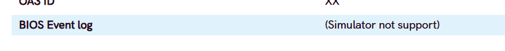

BIOS Event log сообщаяет Simulator not support, в эмуляторе эта фанкция оттсутствует. 

## Задача 10. Полный сценарий: подготовка к переустановке ОС

Цель: Закрепить все навыки в одном практическом задании.
Задание (последовательно):

Сбросить настройки на Factory Defaults (1 мин).
Включить Secure Boot (1 мин).
Установить Supervisor Password (2 мин).
Поставить USB первым в порядке загрузки (2 мин).
Сохранить и выйти (F10) (1 мин).
Снова войти, проверить настройки, сбросить пароль и вернуть порядок загрузки (2 мин).
Критерий готовности: Все шесть шагов выполнены без подсказок, настройки проверены после повторного входа.

Совет: После каждой задачи записывайте точный путь к настройке (например, Security → Secure Boot → Secure Boot Status). Это пригодится при работе с реальным устройством, где интерфейс может немного отличаться, но логика останется той же.

Сбрасываем настройки: Restart → Load Factory Defaults 
Проверяем: Security → Secure Boot → Secure Boot (Он включен по умолчанию)

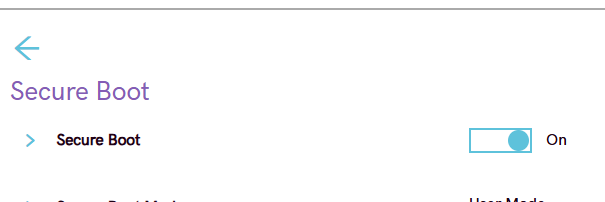

Ставим пароль: Security → Password → Supervisor Password 

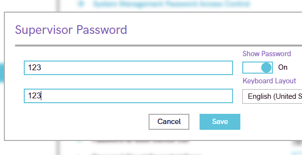

Устанавливаем USB в приоритет: Startup → Boot

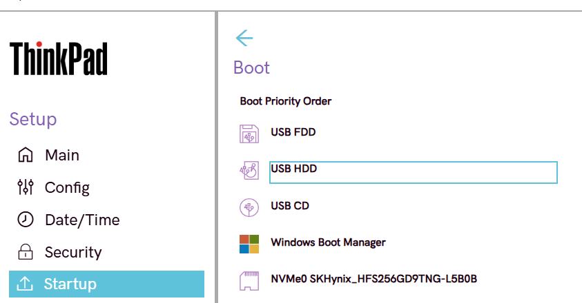

Снова сбрасываем настройки: Restart → Load Factory Defaults 
Сайт эмулятора перезагрузился.

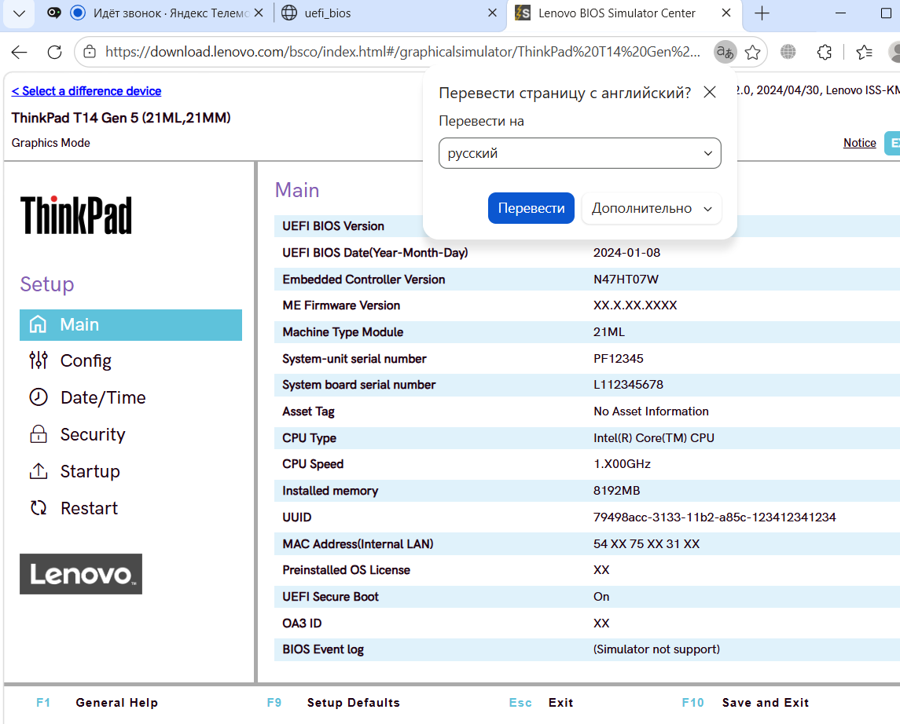